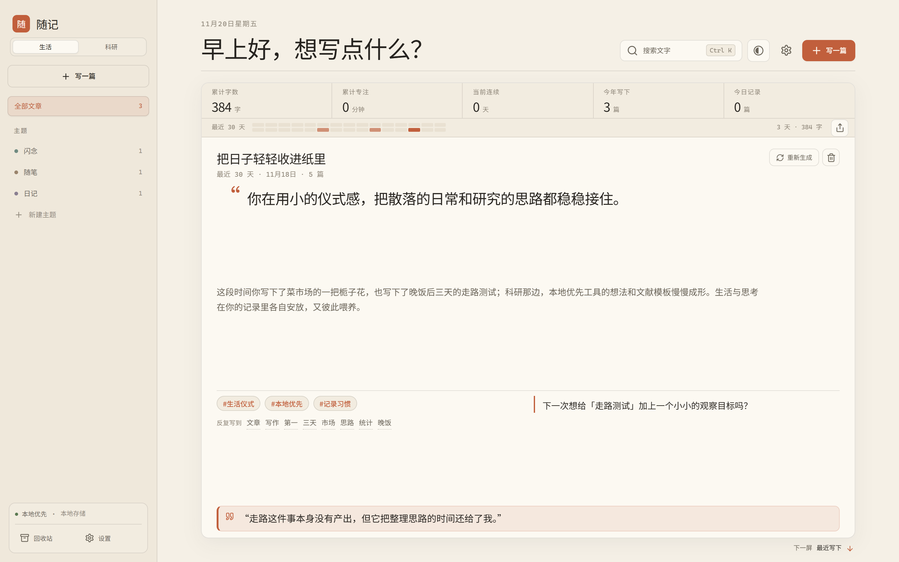
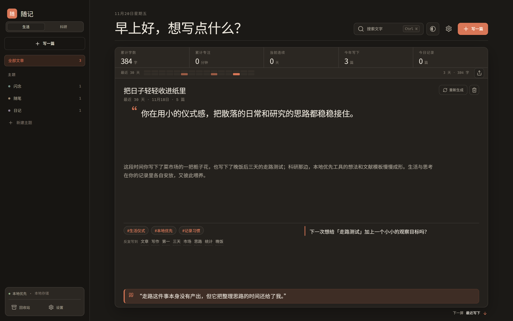
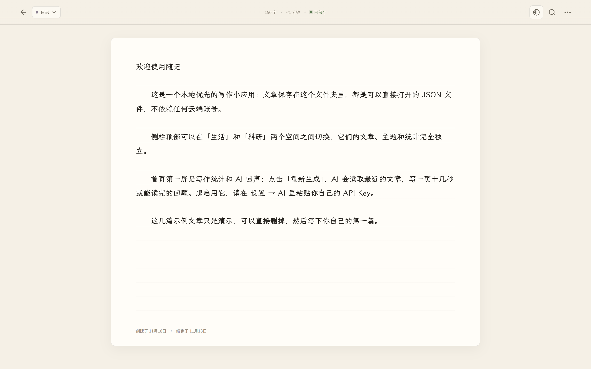
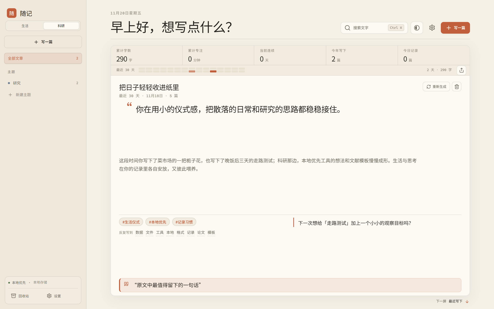
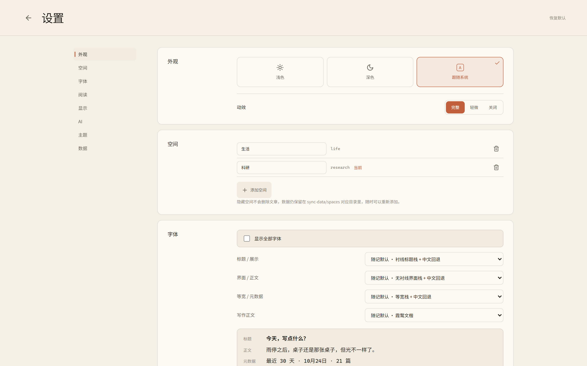

# 随记 · Inkling

> 安静、本地优先的 Windows 写作应用。数据是透明的 JSON 文件，AI 只负责轻轻回看。


随记把每天写下的文字保存在本机：每篇文章是一个可直接阅读的 JSON 文件，不需要账号，也不依赖远程数据库。它提供**生活**与**科研**两个互不干扰的写作空间，并用一页十几秒就能读完的「AI 回声」，帮你回看这段时间真正发生过什么。

## 特性

- **双空间**：生活 / 科研独立数据目录、独立主题、独立统计与回收站，一键切换
- **透明存储**：一篇文章一个 JSON 文件，数据格式即文档，随时可迁移
- **AI 回声**：一句核心 + 两三句解释 + 主题 + 一个问题 + 一句原文引用，双空间融合总结
- **轻量首页**：第一屏是写作统计、30 天热力条与回声，整页下滑进入文章列表
- **编辑器**：首行标题、信纸排版、自动缩进、光标居中、防误存空草稿
- **本地服务**：PowerShell 静态服务 + JSON API，只绑定 `127.0.0.1`
- **备份**：每日自动备份、手动导出完整备份、合并式恢复

> AI 回声只是辅助回看，不做心理诊断，也不构成医疗建议。

## 预览

**首页 · 浅色**



**首页 · 深色**



| 编辑器 | 科研空间 | 设置 |
|---|---|---|
|  |  |  |

## 快速开始

### 环境要求

- Windows 10/11
- Node.js 20+（首次构建需要；日常运行只需 PowerShell）

### 运行

```powershell
# 1. 安装依赖并构建
cd app
npm install
npm run build

# 2. 启动本地服务（纯 PowerShell，之后运行不需要 Node）
cd ..
powershell -File app\scripts\serve-suiji.ps1 -Root app\dist -DataRoot sync-data -Port 4173
```

打开 `http://127.0.0.1:4173` 即可。首次运行自带几篇演示文章，可以直接删除换成你自己的。

也可以用 `app\launcher\启动随记.cmd` 一键启动，或参考 `app/scripts/build-external-launcher.ps1` 生成一个桌面 `随记.exe` 启动器。

### 开发

```bash
cd app
npm install
npm run dev       # Vite 热更新（数据接口仍需本地服务）
npm run test      # Vitest 单元测试
npm run e2e       # Playwright 回归（需先启动本地服务）
```

## 生活与科研

侧栏顶部的滑块用于切换空间，默认是「生活 / 科研」两个：

- 空间数量可在 **设置 → 空间** 调整（1-3 个），每个空间都可以命名
- 隐藏一个空间不会删除文章，数据仍保留在 `sync-data/spaces/` 对应目录
- 两个空间是**独立的数据目录**（`sync-data/spaces/life` 与 `sync-data/spaces/research`），不是一张表里的标签
- 文章、主题、统计、回收站、搜索范围全部按空间隔离
- 当前空间只保存在本机浏览器里，切换只影响这一台电脑
- AI 回声是唯一固定跨空间读取的功能

## AI 回声

回声的形态是固定的：一句核心、两三句解释、三个主题、一个问题、一句原文引用，全文控制在两百字左右。

### 配置

1. 打开 **设置 → AI → 本机连接**
2. 选择提供商预设（DeepSeek 官方、OpenRouter、Kimi、本地 Ollama、OpenCode Go，或任意自定义 OpenAI 兼容 API），Endpoint 和 Model 会自动填充，可再手动调整
3. 粘贴你的 API Key，保存到本机

Key 只保存在本机 `LocalAppData`，不写进浏览器，也不会进入同步或备份文件。只有点击「生成」后文字才会发送到你配置的 API；随记不会自动调用 AI。

### 生成行为

- 默认范围 / 默认读取深度在设置里调整
- AI 始终同时读取两个空间，融合成一页总结，不会在输出里区分「工作/生活」
- 回声保存在 `sync-data/ai-reviews/`，只有一份，两个空间看到同一页

## 数据存储

```text
sync-data/
  spaces/
    life/           # 生活空间
      notes/        #   一篇文章一个 JSON
      topics/       #   主题
      deletions/    #   永久删除标记
    research/       # 科研空间（结构同上）
  ai-reviews/       # AI 回声（两空间共用）
  backups/          # 自动备份（保留 45 天）
  settings.json     # 外观、字体、AI 人设与显示选项
```

文章 JSON 的字段就是数据文档：`id`、`content`、`topicId`、`tags`、`createdAt`、`updatedAt`、`wordCount`、`pinned`、`activeDates`。想迁移或写脚本处理，直接读文件夹即可。

备份与恢复都在 **设置 → 数据**：手动导出完整 JSON、从备份合并导入、浏览每日自动备份。恢复前会先自动生成一份当前数据的安全备份。

## 项目结构

```text
app/
  src/
    pages/          Home / Editor / Settings
    components/     侧栏、统计、AI 回声、搜索、回收站等
    data/           API 封装与 IndexedDB 缓存
    lib/            文本、字体、统计、导出、光标居中
    store/          Zustand 应用状态
  scripts/          PowerShell 本地服务、AI 调用、构建与启动
  public/fonts/     霞鹜文楷、Montserrat（OFL 许可）
  launcher/         Windows 启动器源码
CHANGELOG.md        版本历史
```

技术栈：React 19 · TypeScript · Vite · Zustand · Dexie · framer-motion · lucide-react · PowerShell。

## 设计原则

> Avoid unnecessary secondary labels and descriptions. Let the layout do the explaining.

- 能让布局表达的，不再加一行解释
- 保留真实数据、状态与必要的行为提示
- 视觉层级依靠字号、留白、细线和纸面，而不是堆叠标签

## 许可证

- 代码以 [MIT License](LICENSE) 开源——自由使用、修改、分发，只需保留版权声明
- 霞鹜文楷轻便版：[SIL Open Font License 1.1](app/public/fonts/OFL-LXGW-WenKai.txt)
- Montserrat：[SIL Open Font License 1.1](app/public/fonts/Montserrat-OFL.txt)

> 仓库不附带 Anthropic 品牌字体；若你的电脑安装了同名字体会自动使用，否则回退到开源字体栈。

## 致谢

建立在 React、Vite、Zustand、Dexie、framer-motion、lucide-react 之上，AI 回声支持任何 OpenAI 兼容 API。
