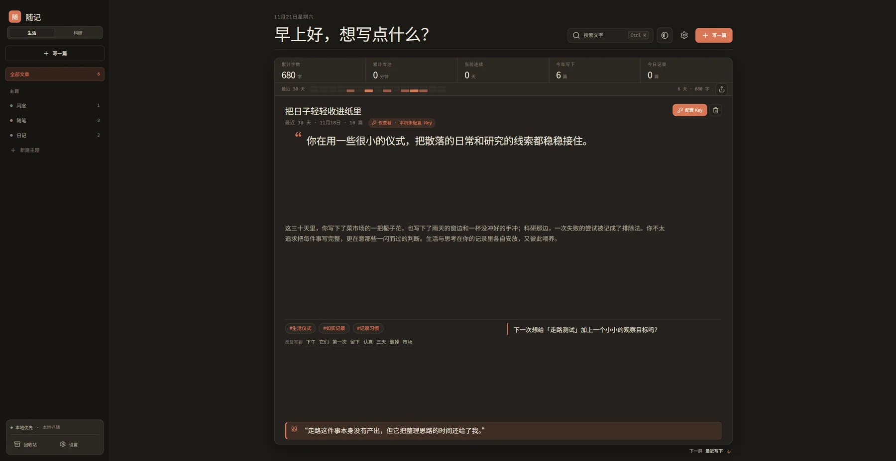
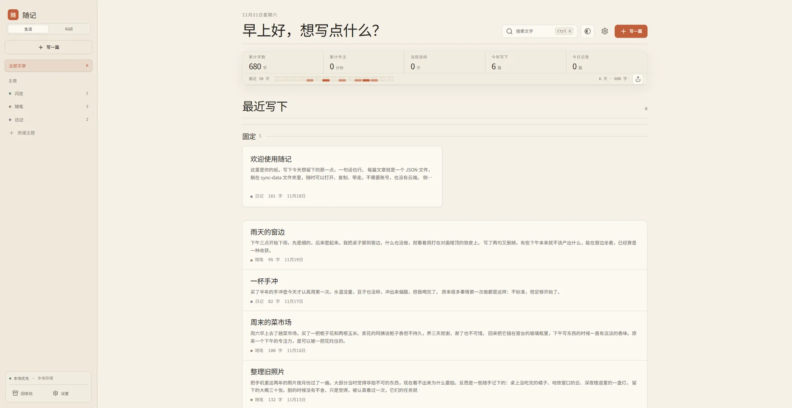
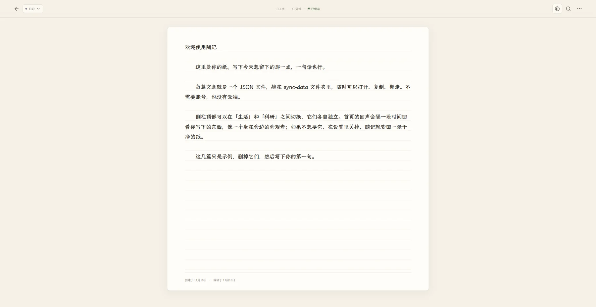
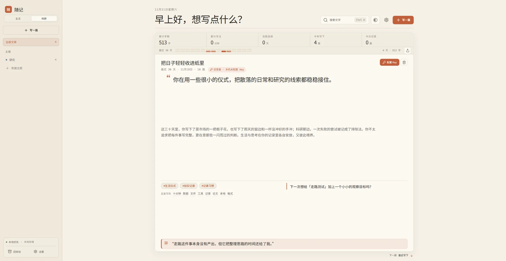
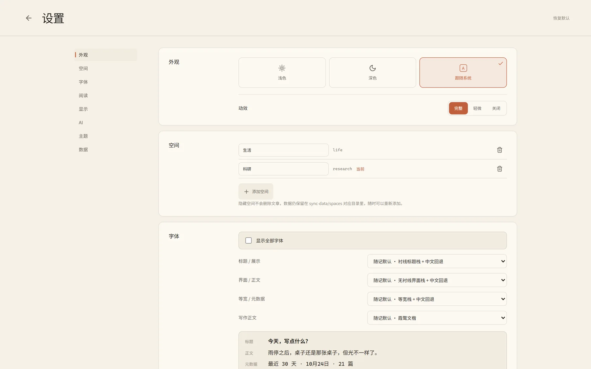

# 随记 · Inkling

> 优雅地记录生活的点点滴滴。


## 它想做的事

把每天想留下的那一点写下来，不被打扰。文字是你的：一篇文章一个 JSON 文件，躺在自己的硬盘上，不需要账号，也不会上传到任何地方。

AI 回声是一个可选的旁观者。它不点评、不说教，只是隔一段时间把你写下的东西轻轻放回你面前——一句核心，两三句话解释，一个值得想想的问题，一句原文引用。像有人坐在旁边，安静地看过，然后说了一句。

不喜欢被看着？**关掉它**。随记会变回一张干净的纸：标题、统计、你的文章，仅此而已。

## 为什么做它

想法总在不对的时候来：地铁上、睡前、刚洗完澡。它们没有地方可去——笔记软件太重，备忘录太单薄，而把自己的文字交给别人的服务器，总有点不安。

随记就是想给这些念头一个安静的落脚处。它用 vibe coding 的方式做出来：边想边写，边写边改，把工程交给 AI，自己只负责判断什么值得留下。


## 两种样子

有回声时，首页是一页写作回顾，往下滑是文章列表：

| 深色 | 关闭 AI 后 |
|---|---|
|  |  |

关闭后没有任何 AI 入口，设置页里也不会再出现相关选项——就是一份安静的本地记录。

| 编辑器 | 科研空间 | 设置 |
|---|---|---|
|  |  |  |

## 别的

- **生活 / 科研**：两个独立空间，各有自己的文章、主题、统计与回收站；数量与名称可自定义（1-3 个）
- **AI 可换**：支持任意 OpenAI 兼容 API（DeepSeek、OpenRouter、Kimi、本地 Ollama、OpenCode Go）
- **数据透明**：目录即数据，随便打开、复制、带走
- **本地服务**：只绑定 `127.0.0.1`，每日自动备份，不会自动调用 AI

## 运行

```powershell
cd app
npm install
npm run build
cd ..
powershell -File app\scripts\serve-suiji.ps1 -Root app\dist -DataRoot sync-data -Port 4180
```

打开 `http://127.0.0.1:4180`。首屏向下滚动进入文章列表，侧栏滑块切换空间。

## 开发

```bash
cd app
npm run dev      # 界面热更新
npm run test     # 29 项测试
```

React 19 · TypeScript · Vite · Zustand · Dexie · framer-motion · PowerShell。

## 致谢

代码工程大量由 **DeepSeek** 完成——数据结构、本地服务、界面实现，大部分是在与它的对话里推进的。界面语言受 **Claude** 启发：暖米色纸面、衬线标题、等宽元数据，以及尽量少说话的克制。

> AI coding 作品：想法与审美来自人，代码与文档由 AI 写成。

## 许可证

代码以 [MIT](LICENSE) 开源；字体遵循各自的 [OFL](app/public/fonts/OFL-LXGW-WenKai.txt) 许可。版本历史见 [CHANGELOG](CHANGELOG.md)，参与方式见 [CONTRIBUTING](CONTRIBUTING.md)。
